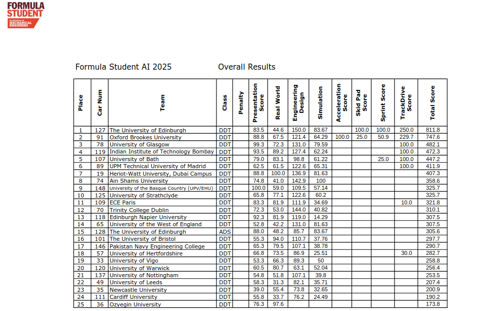
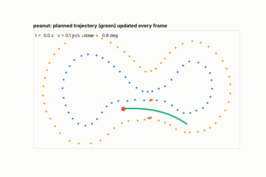

# Autonomous Driving Stack

Hi, I am Faizan. I was the autonomous software developer of **Team FERN** from
**Pakistan Navy Engineering College (PNEC)**. We took part in **Formula Student AI
(FS-AI) 2025 at Silverstone, UK**, and as far as we know it was the first time a team from
Pakistan ran a driverless car there. We finished **17th overall (290.7 points)** in the
Dynamic Driving Task class, where teams write the autonomous software for the IMechE
ADS-DV car.

In FS-AI the car drives itself around a track marked only by cones: blue on the left,
yellow on the right, orange at the start line. All the autonomous software in this repo
(planning, state estimation, mapping and control) is my work; the rest of the team worked
on the other parts of the project. I developed and tested it in the
[EUFS simulator](https://gitlab.com/eufs/eufs_sim) on ROS 2.

<p align="center">
  <br>
  <em>FS-AI 2025 overall results (IMechE). Team FERN / PNEC is car 146, 17th place.</em>
</p>

## What I worked on, in order

1. **Path planning from cone positions.** I started with a simple midpoint planner (middle
   point between blue and yellow cones). It went zig-zag in corners, so I moved to
   **Delaunay triangulation** of the cones, then worked on **RRT / RRT\***, and in the end
   combined the two: the RRT samples around the Delaunay midpoints so the tree grows along
   the track.
2. **EKF** for the car's position, using wheel odometry, IMU and GPS.
3. **Localisation and cone mapping on top of the EKF** (the SLAM part): putting cone
   detections into a map, clustering them, counting laps and detecting loop closure.
4. **Control**: pure pursuit for steering and PID for speed first, then I implemented
   **Stanley** as well to compare the two.

All of these are in this repo, so you can see the planners side by side and compare the
controllers on the same tracks.

<p align="center">
  <br>
  <em>The stack driving the EUFS "peanut" track. Green is the path the planner publishes every frame.</em>
</p>

## What is inside

Everything lives in one folder, [`driverless-software/`](driverless-software), split the way
the car's software is split (each one is a ROS 2 package):

| Folder | What it does |
|---|---|
| [`state_estimation/`](driverless-software/state_estimation) | EKF that fuses wheel odometry, IMU yaw and GPS into the car's pose |
| [`slam/`](driverless-software/slam) | Builds the cone map, corrects the pose against it, counts laps, detects loop closure |
| [`planning/`](driverless-software/planning) | Midpoint planner, Delaunay planner, and RRT guided by Delaunay midpoints |
| [`control/`](driverless-software/control) | Pure pursuit and Stanley steering controllers with PID speed control |
| [`bringup/`](driverless-software/bringup) | One launch file + one params file to run the whole stack with the simulator |
| [`tools/offline_sim/`](driverless-software/tools/offline_sim) | Small Python simulator to test the real nodes without Gazebo |
| [`tests/`](driverless-software/tests) | Automated tests for every module |

The detailed write-up (how each part works, results, what is still not good) is in
[`driverless-software/README.md`](driverless-software/README.md). I will keep adding more
projects next to this folder in future.

## Screenshots from the EUFS simulator

| SLAM | Planning | Pure pursuit |
|---|---|---|
|  |  |  |

## Quick start

```bash
# test everything without ROS (needs numpy, scipy, scikit-learn, pytest)
cd driverless-software
python3 -m pytest tests -q

# drive one lap of every EUFS track in the offline simulator
python3 tools/offline_sim/sim.py
```

To run it with ROS 2 and the EUFS simulator, see
[Running with ROS 2](driverless-software/README.md#running-with-ros-2).

## Credits

- [EUFS simulator](https://gitlab.com/eufs/eufs_sim) (MIT) by Edinburgh University Formula Student, the track files in `tools/offline_sim/tracks` are theirs.
- The EKF started from Atsushi Sakai's [PythonRobotics](https://github.com/AtsushiSakai/PythonRobotics), the GPS conversion is from [geonav_transform](https://github.com/bsb808/geonav_transform).
- The rest of Team FERN, who worked on the other parts of the project and made the competition happen.
- Some of the refactoring (the Delaunay gate planner, the controller clean-up) and the offline test setup were done with help from an AI coding assistant (Claude).
