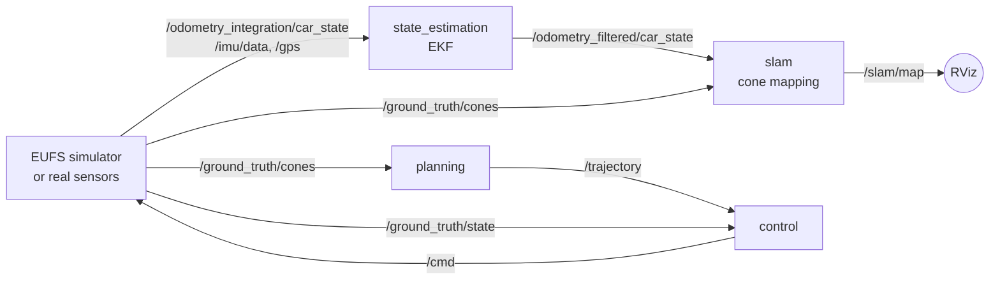

# Driverless Software (Team FERN, FS-AI 2025)

ROS 2 software stack for a Formula Student AI car: state estimation, cone mapping, local path
planning and control. Built by Team FERN for **FS-AI 2025 at Silverstone, UK** and developed
in the [EUFS simulator](https://gitlab.com/eufs/eufs_sim) (ROS 2 Galactic, Ubuntu 20.04,
Python 3.8).


## How the pieces fit



The planner and controller work in the **car frame** (`base_footprint`: x forward, y left).
The cones come in that frame and `/trajectory` goes out in that frame, so the car is always at
(0, 0) facing +x. A lot of our early bugs came from mixing this frame with the map frame,
so now only the EKF and the mapping work in the map frame.

## Packages

### `state_estimation`: EKF
[`ekf_node.py`](state_estimation/state_estimation/ekf_node.py)

State is `[x, y, yaw, v]`. Prediction uses a unicycle model driven by wheel speed and yaw
rate; the update uses position (GPS converted to x/y, or odometry position when there is no
GPS) and the IMU yaw. The maths is kept in a small `EKF` class with no ROS inside, so it can
be tested on its own.


With position noise of 0.6 m (sigma) the filter brings the mean position error from
0.74 m down to 0.20 m.

### `slam`: cone mapping and loop closure
[`cone_mapping_node.py`](slam/slam/cone_mapping_node.py)

Each cone detection is moved into the map frame with the EKF pose. Then
`LocalOutlierFactor` removes stray detections, `DBSCAN` groups detections of the same cone
(the group mean is the cone), a `KDTree` of older cones detects loop closure, and passing the
orange cones counts laps. The map is published on `/slam/map`.


To be honest about the name: this is mapping on top of the EKF pose, not full EKF-SLAM yet.
The cone positions do not correct the car pose. That is the next step (see roadmap).

### `planning`: three planners, one in use
All three subscribe to `/ground_truth/cones` and publish `/trajectory`.

| Node | Idea | Status |
|---|---|---|
| [`midpoint_planner`](planning/planning/midpoint_planner_node.py) | Pair each cone with the nearest cone of the other colour, take midpoints, sort from the car, spline | Baseline, fine on simple tracks |
| [`rrt_planner`](planning/planning/rrt_planner_node.py) | RRT grown from the car, sampling around the Delaunay midpoint chain, cone collision check, smoothed best branch | Experimental, path is wobbly |
| [`delaunay_planner`](planning/planning/delaunay_planner_node.py) | Delaunay triangulation, keep blue-yellow edges ("gates"), walk gate to gate from the car, smoothing spline | **Used** |


The Delaunay planner is the main one. In every triangle that has both colours, exactly two
edges are blue-yellow, so the gates form a simple chain. Walking that chain gives the track
order directly, without any search, and cones from a neighbouring part of the track do not
form gates because they face the same colour. When only one side of the track is visible
(common in tight corners because the camera sees 120 degrees), it falls back to offsetting
the visible boundary by half the track width. The core is in
[`centerline_planner.py`](planning/planning/centerline_planner.py), with no ROS dependency.

The biggest bug in our first planner was pairing `blue[i]` with `yellow[i]` straight from
the message. The message order is not the track order, so in corners it joined cones from
different parts of the track. There is a test for this now
(`test_delaunay_planner_ignores_message_order`).

### `control`: pure pursuit and Stanley
| Node | Steering | Speed |
|---|---|---|
| [`pure_pursuit`](control/control/pure_pursuit_node.py) | `delta = atan(2 L sin(alpha) / l_d)`, look-ahead `l_d = 2.5 + 0.5 v` | `v = sqrt(a_lat / curvature)`, limited so it can still brake for the next corner, PID on acceleration |
| [`stanley`](control/control/stanley_node.py) | `delta = heading_error + atan(k e / (v + k_soft))` on the front axle | same as above |

Both clip steering to the 0.52 rad steering lock of the car.

### `bringup`
[`trackdrive.launch.py`](bringup/launch/trackdrive.launch.py) starts the EUFS launcher and the
whole stack; [`params.yaml`](bringup/config/params.yaml) has every tunable value in one
place.

## Results

Offline simulator, one lap per track, max speed 3 m/s. "Min clearance" is the closest the
centre of the car got to any cone; the car is 1.4 m wide, so above ~0.8 m means nothing was
touched. A cone counts as hit if it came within 0.5 m of the car's centre.

Each cell: lap time, cones hit, min clearance.

| Track | delaunay + pure pursuit | delaunay + stanley | midpoint + pure pursuit | rrt + pure pursuit |
|---|---|---|---|---|
| `small_track` | 33.6 s, 0 hit, 1.59 m | 34.3 s, 0 hit, 1.50 m | 33.5 s, 0 hit, 1.60 m | 32.0 s, 0 hit, 0.77 m |
| `peanut` | 32.5 s, 0 hit, 1.23 m | 33.7 s, 0 hit, 1.14 m | 32.6 s, 0 hit, 1.24 m | 30.4 s, 0 hit, 0.51 m |
| `bone` | 35.9 s, 0 hit, 1.05 m | 37.2 s, 0 hit, 0.94 m | 35.8 s, 0 hit, 1.01 m | 34.1 s, 0 hit, 0.60 m |
| `boa_constrictor` | 28.1 s, 0 hit, 0.89 m | 29.3 s, 0 hit, 1.05 m | 28.1 s, 0 hit, 0.94 m | 26.8 s, 2 hit, 0.31 m |
| `its_a_mess` | 32.2 s, 0 hit, 0.60 m | 34.4 s, 0 hit, 0.61 m | 32.8 s, 0 hit, 0.63 m | 30.2 s, 2 hit, 0.24 m |
| `rectangle` | 30.4 s, 0 hit, 0.84 m | 34.1 s, 1 hit, 0.42 m | 30.7 s, 0 hit, 0.99 m | 29.2 s, 4 hit, 0.33 m |
| `garden_light` | 45.5 s, 2 hit, 0.46 m | did not finish | did not finish | not run |
| `comp_2021` | 65.5 s, 14 hit, 0.10 m | 69.1 s, 1 hit, 0.41 m | 60.5 s, 12 hit, 0.10 m | not run |
| `rand` | 134.2 s, 0 hit, 1.90 m | 137.8 s, 0 hit, 2.02 m | did not finish | not run |
| `hairpins_increasing_difficulty` | 266.8 s, 25 hit, 0.05 m | 277.7 s, 4 hit, 0.05 m | 245.3 s, 16 hit, 0.13 m | not run |

- delaunay + pure pursuit: 10/10 laps, 7/10 without touching a cone
- delaunay + stanley: 9/10 laps, 6/10 without touching a cone
- midpoint + pure pursuit: 8/10 laps, 6/10 without touching a cone
- rrt + pure pursuit: 6/6 laps, 3/6 without touching a cone

RRT re-plans 400 samples every frame, so it was only run on the six shorter tracks.

What I take from this:

- **Delaunay + pure pursuit** is the most reliable combination (finishes every track) and is
  the default. Its weak spot is the tight U-turns of `comp_2021` and
  `hairpins_increasing_difficulty`: their centre-line radius is close to the car's minimum
  turning radius (about 2.8 m = wheelbase / tan(0.52)), and pure pursuit aims at a point a few
  metres ahead, so it cuts the inside of the turn and clips the inner cones.
- **Stanley** follows the path much more tightly in those U-turns (1 cone instead of 14 on
  `comp_2021`), but it lost the track on `garden_light`, which has two rows of blue cones next
  to each other. So the next step is to combine them: Stanley-style cross-track correction with
  pure pursuit look-ahead, or switch controller based on path curvature.
- The **midpoint planner** is fine when both sides of the track are clearly visible but gets
  lost on the more complex tracks, which is why we moved to the Delaunay planner.
- I also tried a minimum-curvature line inside the visible corridor (`racing_line: true`,
  bounded least squares). Because it is re-solved every frame on a partly visible corridor it
  made the other tracks worse, so it is off by default.

## Running with ROS 2

Setup we use: Ubuntu 20.04, ROS 2 Galactic, EUFS sim cloned in the same workspace.

```bash
mkdir -p ~/fs_ws/src && cd ~/fs_ws/src
git clone https://gitlab.com/eufs/eufs_sim.git
git clone https://gitlab.com/eufs/eufs_msgs.git
git clone https://gitlab.com/eufs/eufs_rviz_plugins.git
git clone https://github.com/faizan75669/autonomous-driving-stack.git
cd ~/fs_ws
rosdep install --from-paths src --ignore-src -r -y
colcon build
source install/setup.bash
export EUFS_MASTER=~/fs_ws/src

ros2 launch bringup trackdrive.launch.py
# other planner / controller:
ros2 launch bringup trackdrive.launch.py planner:=rrt_planner controller:=stanley
```

In the EUFS launcher pick a track, keep *DynamicBicycle* + *acceleration* mode, tick RViz and
press Launch. In RViz add a Marker display on `/planner/viz` to see the planned path.

Parameters can be changed live, for example `ros2 param set /controller max_speed 3.5`.

## Testing without ROS

[`tools/offline_sim`](tools/offline_sim) has a small Python simulator that runs the **real**
node classes with a fake `rclpy` ([`fake_ros.py`](tools/offline_sim/fake_ros.py)), a
kinematic bicycle car with the EUFS limits, and the same cone visibility as the EUFS cone
plugin (15 m range, 120 degree field of view).

```bash
pip install numpy scipy scikit-learn matplotlib pytest

python3 -m pytest tests -q                       # 12 tests, about 10 s
python3 tools/offline_sim/sim.py                 # one lap on every track
python3 tools/offline_sim/sim.py peanut --planner rrt_planner --controller stanley
python3 tools/offline_sim/make_figures.py        # regenerate the figures in docs/media
```

It is not Gazebo (no tyre model, no real sensors), but most of our bugs, like wrong frames,
wrong signs and crashes on empty messages, show up here in seconds.

## Roadmap

- [ ] Full EKF-SLAM: add cone positions to the filter state so the map corrects the pose
- [ ] Tighter tracking in hairpins: blend Stanley cross-track correction into pure pursuit
- [ ] Wider line into hairpins (racing line that is stable from frame to frame)
- [ ] RRT* version of the RRT planner (cost-to-come and rewiring)
- [ ] MPC controller to compare with pure pursuit and Stanley
- [ ] Run from real perception (`/fusion/cones`) instead of ground-truth cones

## Folder layout

```
driverless-software/
├── state_estimation/   EKF node (+ GPS lat/lon -> x/y conversion)
├── slam/               cone mapping, loop closure, lap counting
├── planning/           delaunay_planner, midpoint_planner, rrt_planner
├── control/            pure_pursuit, stanley
├── bringup/            trackdrive.launch.py, params.yaml
├── tools/offline_sim/  fake ROS, simulator, EUFS track files, figure script
├── tests/              pytest tests for every package
└── docs/media/         figures used in this README
```
