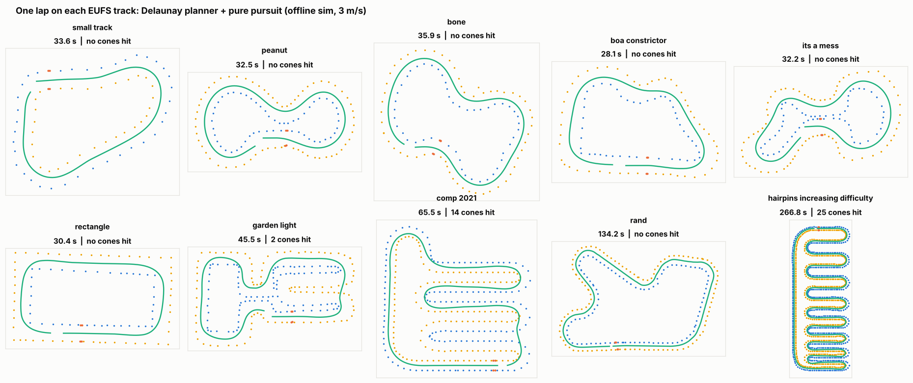
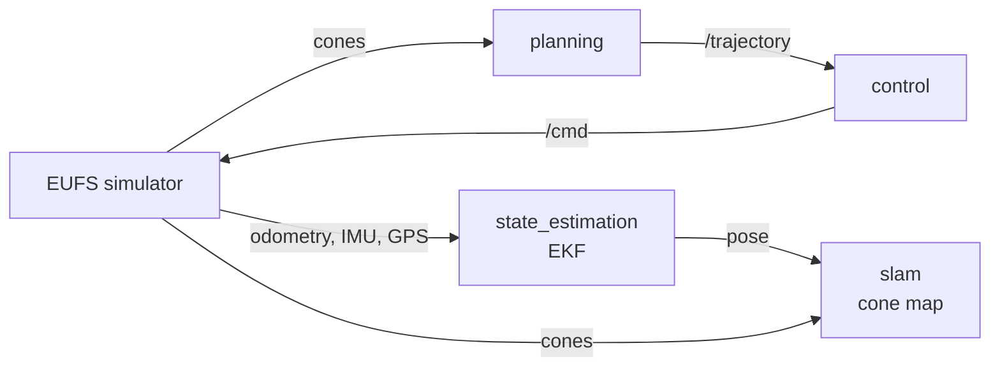
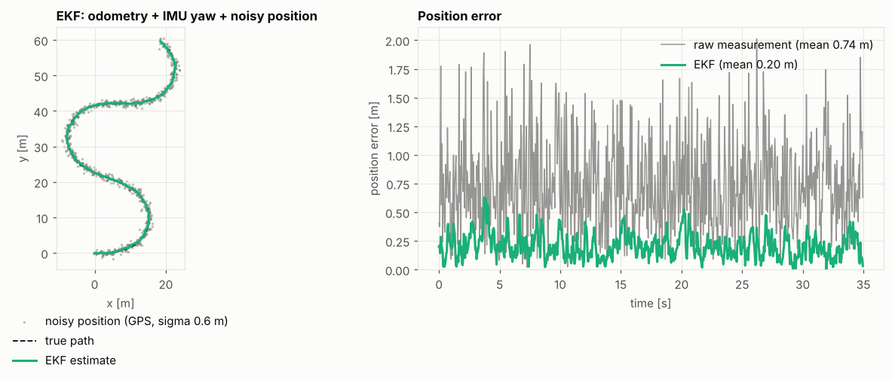
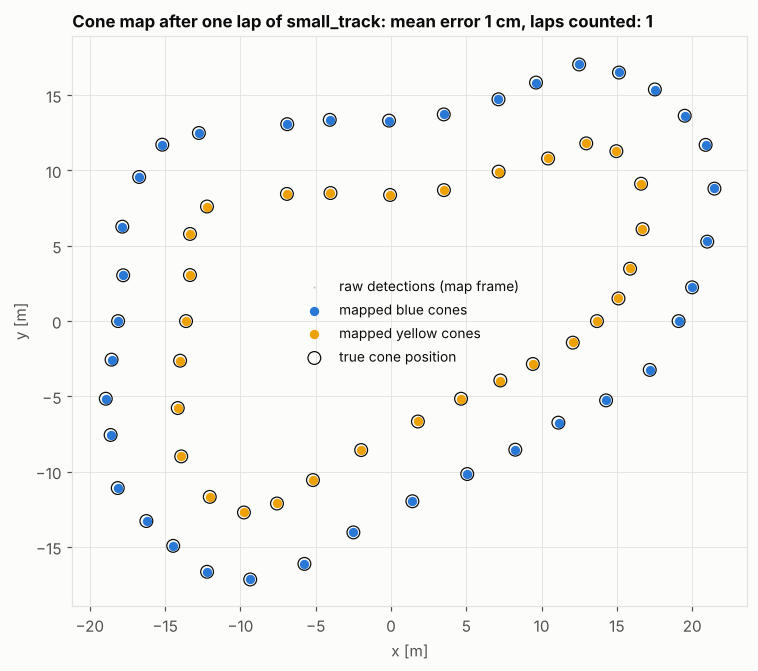
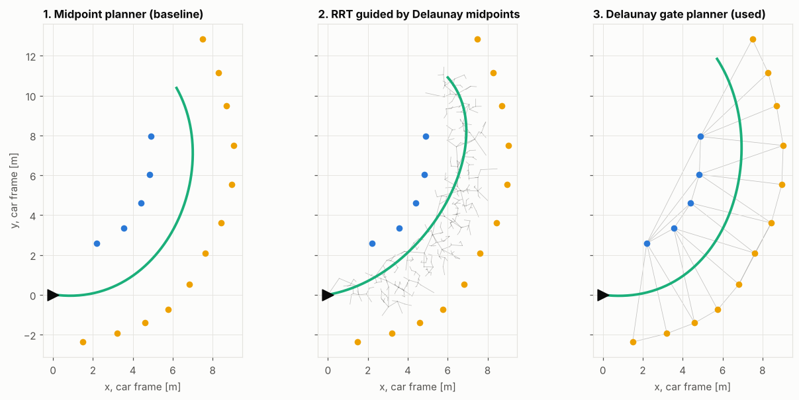

# Driverless Software (Team FERN, FS-AI 2025)

This is the ROS 2 autonomous software I wrote for Team FERN (PNEC) for Formula Student AI
2025 at Silverstone, UK, where we finished 17th overall: state estimation, cone mapping,
path planning and control. I developed everything in the [EUFS simulator](https://gitlab.com/eufs/eufs_sim)
(ROS 2 Galactic, Ubuntu 20.04, Python 3.8).



## How it fits together



Planning and control work in the car frame (car at 0,0 looking along x), because the cones
come in that frame. Only the EKF and the mapping use the map frame. Mixing these two frames
was the cause of a lot of my early bugs.

## The packages

### state_estimation (EKF)
State is `[x, y, yaw, v]`. It predicts with wheel speed and yaw rate (plus the small slip
angle in corners), and corrects with GPS position and IMU heading. Without GPS it just
dead-reckons, because the integrated odometry position keeps drifting and is not a real
measurement. It started from the PythonRobotics EKF example.



### slam (localisation and cone map on top of the EKF)
Every cone detection is put in the map frame using the EKF pose. Close detections count
more than far ones (camera depth noise grows a lot with distance). DBSCAN groups the
detections of the same cone, and LocalOutlierFactor keeps random wrong detections out.
The node also nudges the pose using cones it has already mapped, counts laps at the orange
start line and detects loop closure when it sees cones from more than 30 s ago.

It publishes `/slam/map` and `/slam/pose`, `/slam/reset` clears the map, and with
`plot: true` it shows a live map with the EKF uncertainty ellipse.



### planning
I did the planners in this order:

1. **Midpoint planner**: middle point between each cone and the nearest cone of the other
   colour, sorted from the car, then a spline. Simple, works when the track is clear, but
   my first version paired cones in the order they came in the message and went zig-zag in
   corners.
2. **Delaunay planner** (the one I use): triangulate the cones, keep the blue-yellow edges
   ("gates"), walk from gate to gate starting at the car, fit a spline. It does not get
   confused by cones from other parts of the track, because those never make a blue-yellow gate.
3. **RRT with Delaunay**: an RRT grown from the car, sampling around the Delaunay midpoints,
   with collision checks against the cones, then the best branch is smoothed. I also worked
   on RRT\*, but the version in this repo does not do the RRT\* rewiring step yet, so it is
   plain RRT and the path is a bit wobbly. Finishing RRT\* is on the to-do list.



### control
I did pure pursuit for steering with a PID on speed first, then implemented Stanley to
compare the two. The target speed comes from the curvature of the path, so the car slows
down before corners.

### bringup
One launch file and one `params.yaml` with all the settings.

## Results

All results are from my offline simulator (see below), max speed 3 m/s.

**Driving one lap** (Delaunay planner):

| Track | Pure pursuit | Stanley |
|---|---|---|
| small_track, peanut, bone, boa_constrictor, its_a_mess, rand | lap done, no cones hit | lap done, no cones hit |
| rectangle | no cones hit | 1 cone hit |
| garden_light | 2 cones hit | did not finish |
| comp_2021 | 14 cones hit | 1 cone hit |
| hairpins_increasing_difficulty | 25 cones hit | 4 cones hit |

The bad ones are the tight hairpins. Their radius is close to the smallest radius the car can
turn (about 2.8 m), and pure pursuit cuts the inside of the turn. Stanley follows the path
more closely there but got lost on garden_light. So the next thing to try is mixing the two.

**Mapping** (two laps, EKF + mapping with noisy sensors):
- With GPS: around 10 cm average cone error on every track I tried, no fake cones, and all
  980 cones on the hairpins track.
- Without GPS: the shape of the map is right on normal tracks, but the whole map can be shifted
  by the odometry drift (up to about 35 cm).
- Without GPS on the long `rand` track the drift gets too big (over 1 m) and the map gets
  duplicate cones. That needs proper pose-graph SLAM, which I have not done yet.

The full numbers are printed by `results_table.py` and `slam_eval.py` in `tools/offline_sim`.

## Running it with ROS 2

```bash
mkdir -p ~/fs_ws/src && cd ~/fs_ws/src
git clone https://gitlab.com/eufs/eufs_sim.git
git clone https://gitlab.com/eufs/eufs_msgs.git
git clone https://gitlab.com/eufs/eufs_rviz_plugins.git
git clone https://github.com/faizan75669/autonomous-driving-stack.git
cd ~/fs_ws
rosdep install --from-paths src --ignore-src -r -y
colcon build
source install/setup.bash
export EUFS_MASTER=~/fs_ws/src

ros2 launch bringup trackdrive.launch.py
# other planner / controller:
ros2 launch bringup trackdrive.launch.py planner:=rrt_planner controller:=stanley
```

In the EUFS launcher pick a track, keep DynamicBicycle + acceleration, tick RViz and press
Launch. Add a Marker display on `/planner/viz` in RViz to see the path.

## Testing without ROS

Starting Gazebo every time was too slow for debugging, so `tools/offline_sim` has a small
simulator that runs the real nodes with a fake `rclpy`, a simple car model and the EUFS
track files.

```bash
pip install numpy scipy scikit-learn matplotlib pytest
python3 -m pytest tests -q                  # 18 tests
python3 tools/offline_sim/sim.py            # one lap on every track
python3 tools/offline_sim/slam_eval.py      # EKF + mapping with noisy sensors
```

It has no tyre model or real sensors, so passing here does not mean it works in Gazebo, but
most of the bugs (wrong frame, wrong sign, crash on an empty message) show up here quickly.

## To do

- [ ] Pose-graph SLAM so long runs without GPS stay consistent
- [ ] Mix Stanley and pure pursuit for the tight hairpins
- [ ] Finish RRT* (add the rewiring step to the RRT planner)
- [ ] Try an MPC controller
- [ ] Run from real perception instead of ground-truth cones

## Folders

```
driverless-software/
├── state_estimation/   EKF
├── slam/               cone map, laps, loop closure
├── planning/           delaunay, midpoint and rrt planners
├── control/            pure pursuit, stanley
├── bringup/            launch file + params
├── tools/offline_sim/  small simulator, track files, figure scripts
├── tests/              tests
└── docs/media/         pictures for this README
```
