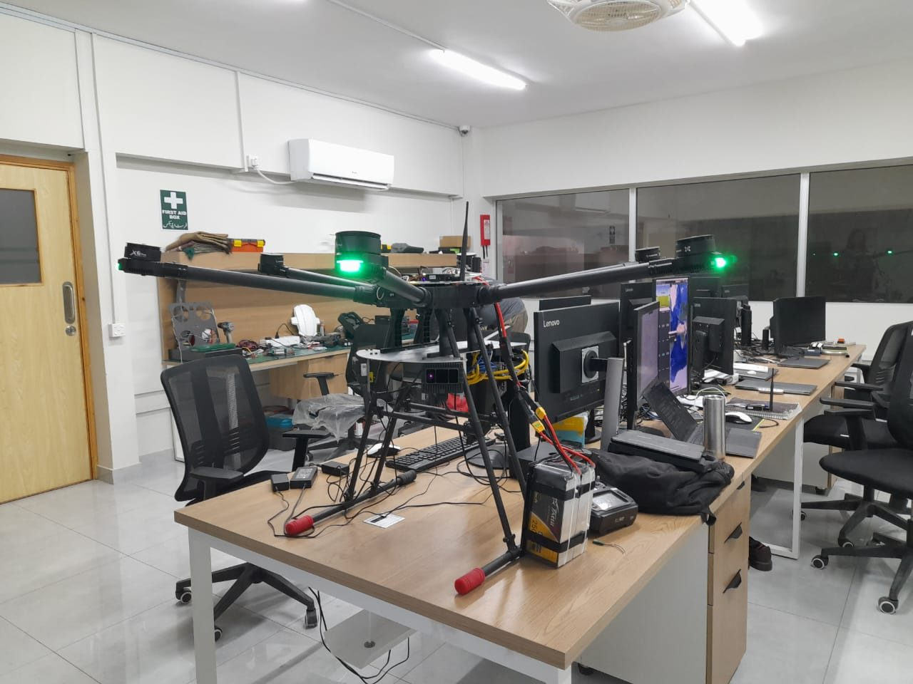
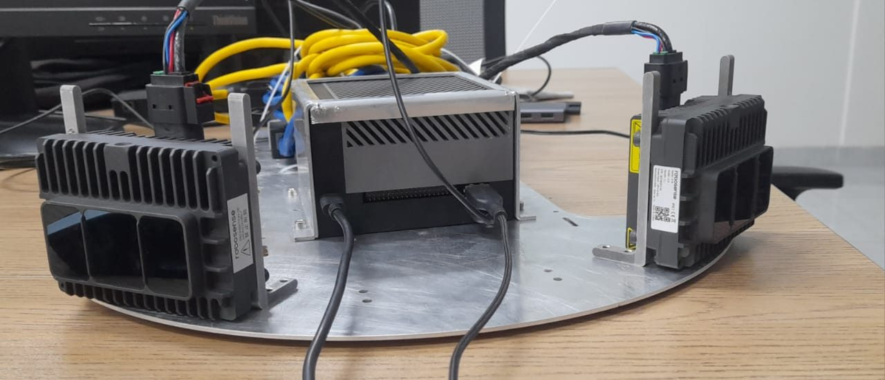
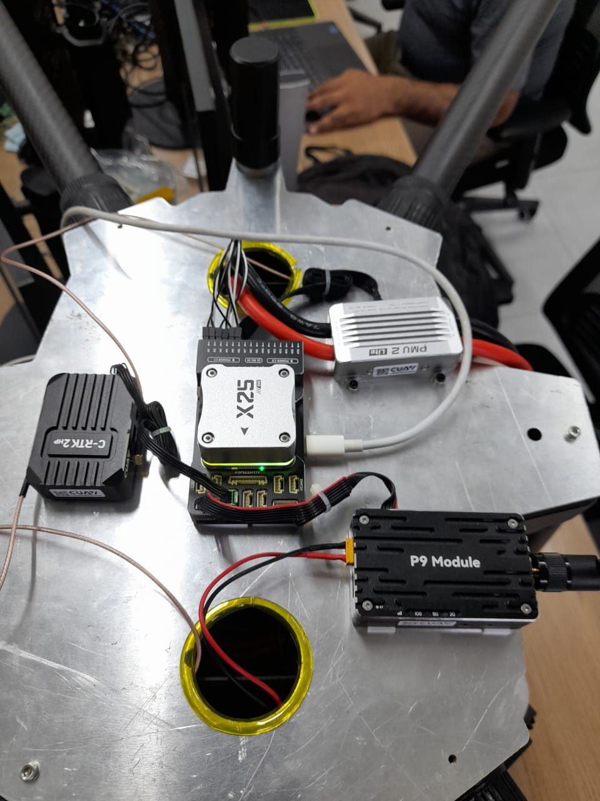
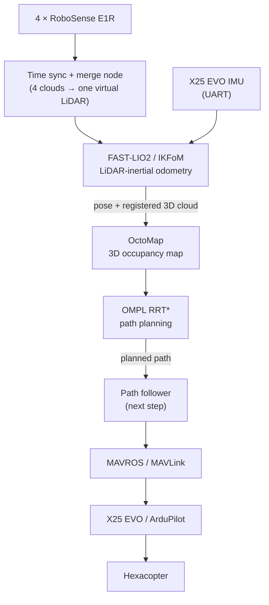
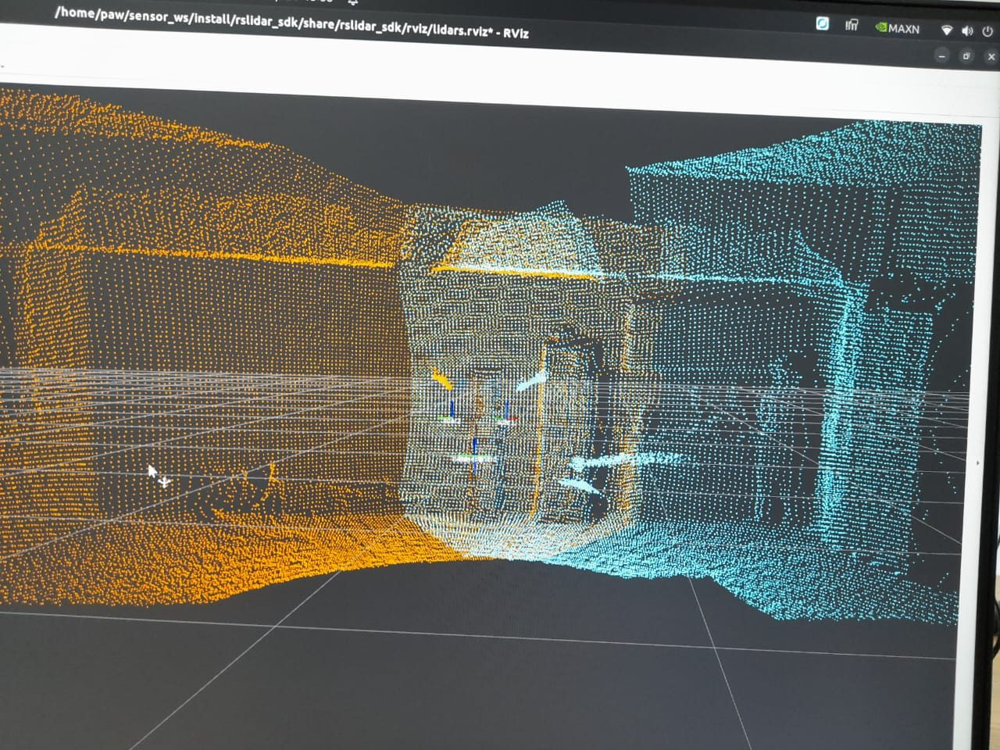
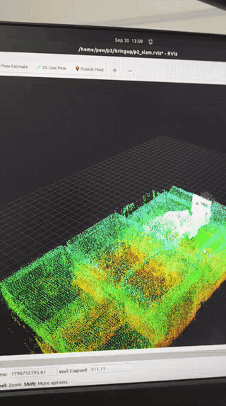
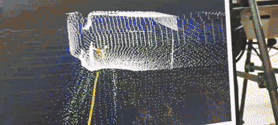
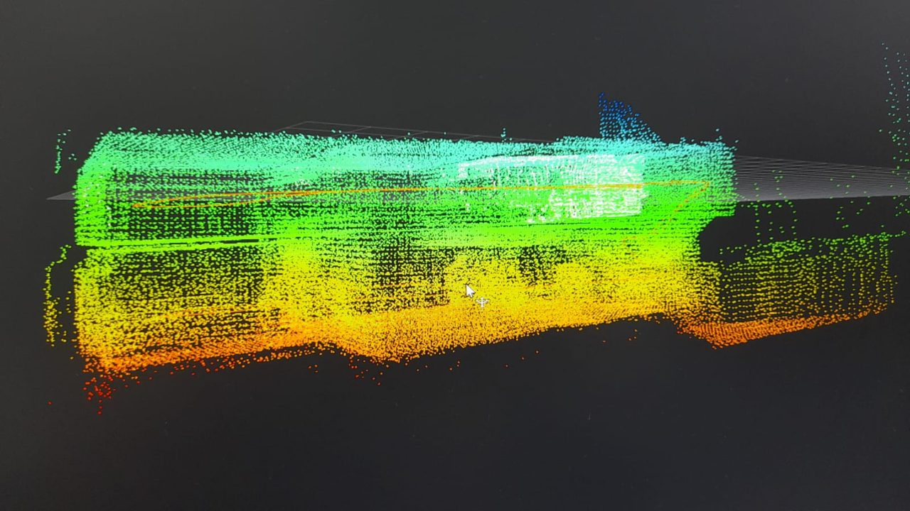
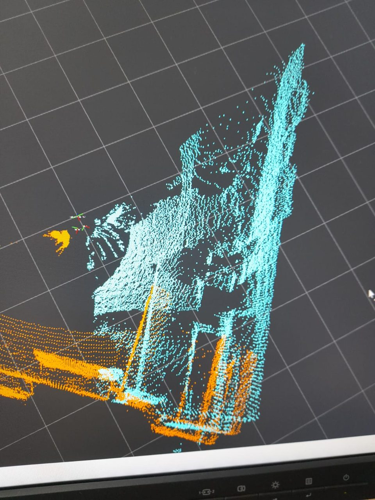

# GPS-Denied Navigation for a Hexacopter (Prodigy Airworks)

At Prodigy Airworks I worked on making the company's heavy-lift hexacopter navigate on its
own without GPS. The idea is simple: if GPS is jammed, blocked or just not there (indoors,
under structures), the drone should still know where it is, build a map of what is around
it and plan a safe path through it. For that I built the navigation stack around LiDAR SLAM,
starting from the perception layer.

> **About the code:** the source code belongs to Prodigy Airworks and is confidential, so it
> is not in this repo. This folder explains what I built, why I made the choices I made, and
> shows it running. Photos and screenshots are shared with the company's permission.

   
  <em>The hexacopter in the lab.</em>

## Hardware

| Part | What it is |
|---|---|
| Computer | NVIDIA Jetson AGX Orin 64 GB, runs everything on board |
| LiDARs | 4 × RoboSense E1R solid-state LiDAR, 120° horizontal × 90° vertical field of view each |
| IMU | from the CUAV X25 EVO flight controller (ArduPilot), connected to the Jetson over UART |
| Network | LiDARs on Ethernet to the Jetson, through an unmanaged switch in the first setup |

| | |
|---|---|
|  |  |
| LiDAR plate with the Jetson AGX Orin in the middle | X25 EVO flight controller on the top plate |

## The pipeline

Everything up to the planned path is working. The path follower (turning the path into
setpoints for ArduPilot) is the next part.

## 1. Mounting the four LiDARs

One E1R sees 120° horizontally, so one is not enough for a drone that can fly in any
direction. I mounted four of them on the same plane, 90° apart. With 120° each and 90°
spacing, every LiDAR overlaps its neighbour by about 30°, and together they cover the full
360° around the drone with no gaps, 90° vertically.

The overlap is on purpose (no blind spots between sensors), but it also means the same wall
or object is seen by two LiDARs at once. That is what made the next step necessary.

## 2. Time synchronisation and clocking

Every LiDAR stamps its points with its own clock. If the four clocks do not agree, a wall
seen by two LiDARs in the overlap area lands in two slightly different places in the map
while the drone moves. You get double walls and "ghost" copies of objects, and the map
stops being consistent.

So all four LiDARs had to be synchronised to one clock, the Jetson's, so that a point from
any LiDAR has a timestamp that means the same thing. In the first setup the LiDARs were
connected through an unmanaged Ethernet switch.

## 3. One virtual LiDAR for FAST-LIO2

FAST-LIO2 works with exactly one LiDAR and one IMU. Instead of changing FAST-LIO2 itself, I
wrote a node that:

1. subscribes to the four LiDAR clouds,
2. moves each cloud into one common body frame using the mounting position and angle of
   that LiDAR (the extrinsics),
3. merges them into one point cloud and publishes it as if it came from a single LiDAR.

FAST-LIO2 then sees one 360° LiDAR plus the X25 EVO's IMU, and works normally.

   
  <em>Two of the LiDARs (orange and cyan) in RViz, overlapping in the middle.</em>

## 4. Why FAST-LIO2

I went with FAST-LIO2 because:

- **It is tightly coupled.** LiDAR and IMU go into one iterated Kalman filter (IKFoM), so
  the IMU fills in between LiDAR scans. This matters on a drone, which can rotate fast.
- **It does not need features.** It registers the raw points directly against the map
  (no edge/plane feature extraction), so it works with solid-state LiDARs like the E1R,
  which do not have the classic spinning ring pattern that feature-based methods assume.
- **It removes motion blur from each scan.** The IMU is used to correct the points for
  the motion during the scan (de-skewing).
- **It is fast enough for the Jetson.** The incremental ikd-tree map keeps it light, and it
  gives high-rate odometry from the IMU between scans.
- **It is open source and there is a ROS 2 version.**

## 5. Mapping with OctoMap

FAST-LIO2 gives the pose and a registered point cloud, but a planner needs to ask "is this
space free or not". So the cloud goes into OctoMap, which builds a 3D occupancy map.

One thing I learned here: OctoMap clears free space by tracing rays from the sensor to each
point, so it has to know where the sensor actually is. When I fed it the cloud without the
correct moving sensor origin, old obstacles were not cleared properly and "ghost" obstacles
stayed in the map. Giving it the current cloud in the body frame, with the fixed map frame
and the moving body frame set correctly, fixed it.

   
  <em>The 3D map being built in RViz, coloured by height.</em>

## 6. Path planning with RRT*

The planner is OMPL's RRT*. It reads the pose from FAST-LIO2 and the OctoMap, and plans a
collision-free path ahead of the drone. For the first autonomous mode I keep the altitude
fixed and plan in X-Y, but every collision check is done in 3D against the OctoMap with
the drone's size around the path. Fixing the altitude makes the problem simpler while
localisation, mapping and control are being proven, and it can be extended to full 3D later.

## Running

   
  <em>A mapping run (sped up): the map building around the sensor, with the estimated path.</em>

| | |
|---|---|
|  |  |
| Map of the lab, coloured by height | Overlapping LiDAR clouds in RViz |

## Where it is now

- Done: 4-LiDAR mounting, time sync, merge node, FAST-LIO2 with the X25 EVO IMU, OctoMap,
  RRT* planning, all running on the Jetson.
- Next: the path follower, sending setpoints to ArduPilot through MAVROS, testing the whole
  loop in ArduPilot SITL, then real flights going from slow and restrained to GPS-denied
  obstacle avoidance.

The drone is not flying fully autonomously yet. The perception, localisation, mapping and
planning part is what I built and got working.

## Software used

ROS 2 Humble, [FAST-LIO2](https://github.com/hku-mars/FAST_LIO) (HKU MARS lab),
[OctoMap](https://octomap.github.io/), [OMPL](https://ompl.kavrakilab.org/), MAVROS,
ArduPilot, RoboSense `rslidar_sdk`.
